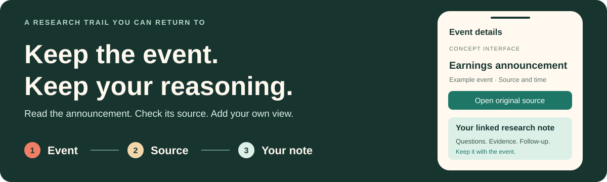

<div align="center">

# QuantLens

**Hong Kong company events. Original sources. Your own research notes.**

A planned Android app for students and finance learners who want to keep their research connected.

[Business Plan](docs/BusinessPlan.md) · [Download PDF](docs/BusinessPlan.pdf) · [Features](#first-release-features) · [Technical Plan](#technical-plan) · [Team](#team-7)



**Team 7** &nbsp; / &nbsp; **Autumn 2026** &nbsp; / &nbsp; **Product Design & Planning**

</div>

> **Project status**  
> The business plan and repository documentation are prepared. Android implementation and user testing have not started. The interface above is a concept, not a running app.

## Why QuantLens?

Reading an announcement is only the start. The source may stay in one browser tab, a question in a notebook and an earlier interpretation somewhere else. QuantLens is designed to keep those pieces together, so a learner can return to an event and understand what they thought at the time.

| Keep the context | Make it easy to check | Leave a record |
| --- | --- | --- |
| Link each research note to the company event it concerns. | Show the original source, publication time and data date where they are needed. | Keep the first interpretation and add observations as new information appears. |

## A Research Session

1. **Find a company** by name or stock code, or open it from your watchlist.
2. **Read an event** and check its category, summary and publication time.
3. **Open the original source** to verify details that matter to your research.
4. **Write a linked note** with your interpretation, evidence, questions and follow-up points.
5. **Come back later** to review the note and add observations without losing the event it belongs to.

Access to the first release will be by invitation, using trial accounts issued by the team.

## First-Release Features

Four main destinations will organize the app:

| Screen | What users will be able to do |
| --- | --- |
| **Watchlist** | Search and follow companies; open stock details with a simple price trend and its data date. |
| **Events** | Browse company events, read summaries and follow links to the original information. |
| **Notes** | Save an interpretation and its evidence, revisit earlier notes, add observations and export records locally. |
| **Settings** | Check account and data status, and sign out. |

Across these screens, the design will distinguish loading, empty, failed and cached states. Saved notes will stay on the device, with records separated by account.

<details>
<summary><strong>First-release boundaries</strong></summary>

- **Included:** invited-user authentication, periodic stock and event updates, local records, essential offline caches and local export.
- **For later evaluation:** cross-device synchronization, push notifications, automatic summaries and advanced research tools.
- **Outside the first release:** self-service registration, password recovery and payments.

Authentication and data services still need to be selected. Coverage, permissions, costs and source-link behaviour will be checked before integration.

</details>

## Technical Plan

The client is planned around **Kotlin and Jetpack Compose**, developed in **Android Studio**. Screens will share a single `MainActivity`.

| Part | Planned responsibility |
| --- | --- |
| **Jetpack Compose** | Display content, collect input and make screen states visible. |
| **ViewModel** | Manage loading, success, empty and failure states. |
| **Repository** | Provide a common way to read and update local and network data. |
| **Room** | Persist watchlists, research notes and essential event caches on the device. |
| **Navigation Compose** | Manage destinations and the back stack; confirm the design before implementation. |
| **HTTPS services** | Authenticate trial accounts and deliver permitted stock and event information. |

Dependency versions and the server-side implementation will be confirmed when the project is established.

<details>
<summary><strong>Navigation and return behaviour</strong></summary>

| Action | Intended behaviour |
| --- | --- |
| Open a detail screen | Pass a `stockId`, `eventId` or `noteId`, then load its content through the data layer. |
| Log in successfully | Open Watchlist and remove the login flow, so Back does not reopen it. |
| Save a note | Confirm a successful database write before returning to the actual source screen. |
| Save fails | Stay in the editor and preserve the input. |
| Back with unsaved changes | Offer save and return, discard, or continue editing. |
| Log out or switch accounts | Clear the session, business-screen history and account-related restored state. |

Internal navigation will use `navigate`, `popBackStack` and `popUpTo`, rather than create a separate Activity for every screen. Kotlin's `return` only ends a function; it does not navigate to another screen. Toolbar Back, system Back and bottom-navigation behaviour will be checked separately.

</details>

<details>
<summary><strong>Persistence, offline use and account boundaries</strong></summary>

- **One content source:** detail screens and lists will observe the same stored records after a save. An optional one-time `noteId` result will be cleared after consumption.
- **Durable notes:** Room will preserve saved content across app restarts. ViewModel will manage screen state, not replace persistent storage.
- **Temporary state:** input and list position may use `rememberSaveable` or `SavedStateHandle` where appropriate. Passwords will not enter restorable screen state.
- **Visible freshness:** cached content will show its age and offline status. Empty results, missing caches and failed requests will have different messages.
- **Account checks:** initial authentication requires connectivity; an expired session requires reauthentication. Personal records will be read according to account ownership.
- **Service access:** credentials will stay on the server, which will enforce permissions. The first release will offer local export; cloud synchronization remains a later option.

Before an invited pilot, the team will check authentication, account isolation, external access, saving and rereading, offline behaviour, source links, installation and upgrades. A signed APK will be shared after these checks.

</details>

## Delivery Plan

| Stage | Status | Main deliverable |
| --- | --- | --- |
| **Define** | Documentation prepared | Product scope, business plan and README; presentation materials coordinated separately. |
| **Build** | Planned | A Compose app with login, navigation, watchlists, event reading and persistent notes. |
| **Invite** | Planned | An online pilot after core checks, with feedback used to improve the workflow. |

Later development dates will follow the course schedule and actual progress.

<details>
<summary><strong>User research and pilot plan</strong></summary>

| Activity | Planned participation | Purpose |
| --- | --- | --- |
| Interviews | **5 interviews** | Understand recent research tasks, source checking and note-taking habits. |
| Prototype sessions | **5 users** | Find confusing steps before implementation is expanded. |
| Online pilot | **10-20 invited users** | Observe independent task completion and later voluntary use. |

Recruitment will begin with classmates, finance study groups and campus societies, with organizers' permission where needed. Participants may voluntarily recommend the trial to others.

**Shared task:** log in, find an event for a specified company, verify its source, save a linked note, then return and reopen it.

Login will be timed separately. We will record completion, time taken, difficulties and subsequent use, with participant counts and observation periods. Source access and note persistence are basic acceptance checks. These figures are recruitment plans, not measured results.

The first release will be free for invited users. Actual service costs and continued use will guide any later pricing decisions; the [business plan](docs/BusinessPlan.md#7-business-model-and-costs) explains the cost assumptions and metrics.

</details>

## Team 7

Each member owns a main module and shares research, testing and documentation. The initial allocation is **approximately one quarter of the workload per person**, with coordination included in the leader's allocation and server-side work estimated separately.

| Team&nbsp;member | Role | Planned ownership |
| --- | --- | --- |
| **段博铧** | **Team Leader** | Navigation, sessions and integration; product scope, plan consolidation and submission coordination. |
| **胡与同** | Client Development | Login UI, search, watchlists and stock details; competitor research, prototypes and module tests. |
| **张胡文康** | Events & Data Integration | Event lists and details, source links and network states; API integration, interviews and source verification. |
| **陈钰龙** | Notes & Local Storage | Note editing, Room, review, export and save-return behaviour; pilot metrics and cost tracking. |

**Cross-review pairs:** 段博铧 ↔ 胡与同 · 张胡文康 ↔ 陈钰龙.

Tasks will be rebalanced as their difficulty becomes clear. Contributions will be recorded through actual deliverables, commits, reviews and test evidence.

## Project Documents

| Document | Contents |
| --- | --- |
| [Business Plan - Markdown](docs/BusinessPlan.md) | Full product, market, development, validation and cost plan, with references. |
| [Business Plan - PDF](docs/BusinessPlan.pdf) | The formatted nine-page version for reading or submission. |

```text
2026-Autumn-Aberdeen-7-QuantLens/
├── README.md
└── docs/
    ├── BusinessPlan.md
    ├── BusinessPlan.pdf
    └── assets/
        └── quantlens-banner.svg
```

<details>
<summary><strong>Course and submission details</strong></summary>

| Item | Details |
| --- | --- |
| Course | Mobile Smart Application Development |
| Semester | Autumn 2026 |
| Team | Team 7 |
| Organization | `android-app-development-course` |
| Repository | `2026-Autumn-Aberdeen-7-QuantLens` |
| GitHub deadline | Before 21 October, as specified in the course brief. |
| Presentation | 21 October, 18:30, Laboratory 110. |
| Documentation updated | 20 October 2026 |

</details>

## Working Together

- Give each task an owner, a deliverable and an acceptance check.
- Review cross-module changes through branches and pull requests, following the course organization's rules.
- Use individual GitHub accounts for work actually completed; keep interview records anonymous and personal contact details outside the repository.
- Display data within the relevant permissions and retain required attribution and licence information for third-party code and materials.

<p align="center"><sub>QuantLens · Team 7 · Mobile Smart Application Development · Autumn 2026</sub></p>
